# ◐ Dig — Deep Research Agent

A multi-agent research assistant. Give it a topic and it searches the web, reads the best source, writes a structured report, and then has a critic score that report out of 10.

Built with **LangChain**, **Tavily**, **OpenAI / Groq** and **Streamlit**.

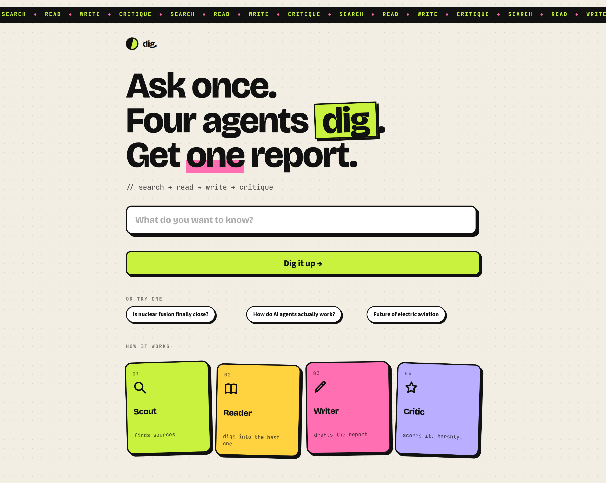

---

- [Screenshots](#screenshots)
- [How it works](#how-it-works)
- [Project structure](#project-structure)
- [Getting started (local)](#getting-started-local)
- [Environment variables](#environment-variables)
- [Deploy on Render](#deploy-on-render)
- [Limitations](#limitations)

---

## Screenshots

### Live progress: every agent is visible

Each card lights up while its agent works, then turns green and shows how long it took.

| Scout | Reader |
|---|---|
| 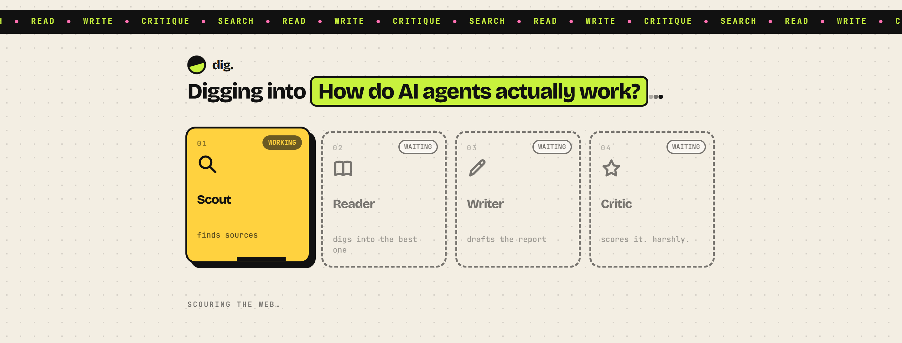 | 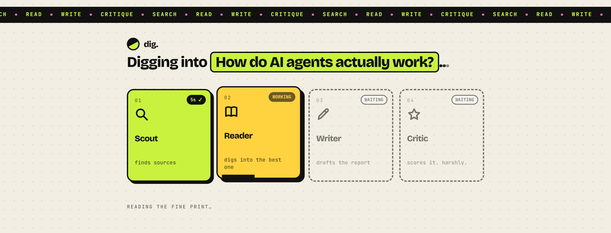 |
| **Writer** | **Critic** |
| 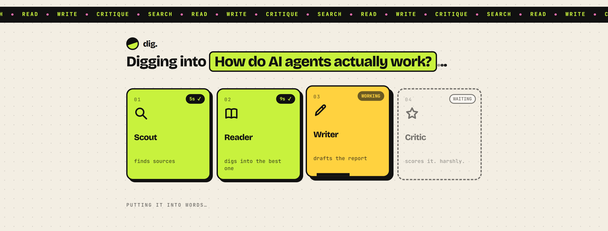 | 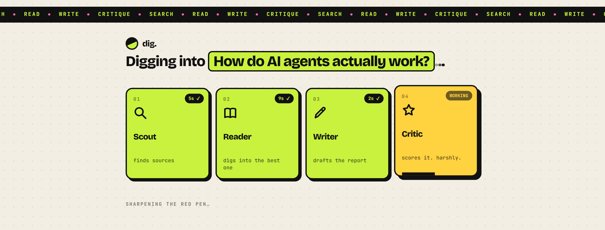 |

### Score + report

The critic's score and one-line verdict sit on top, with the full report underneath.

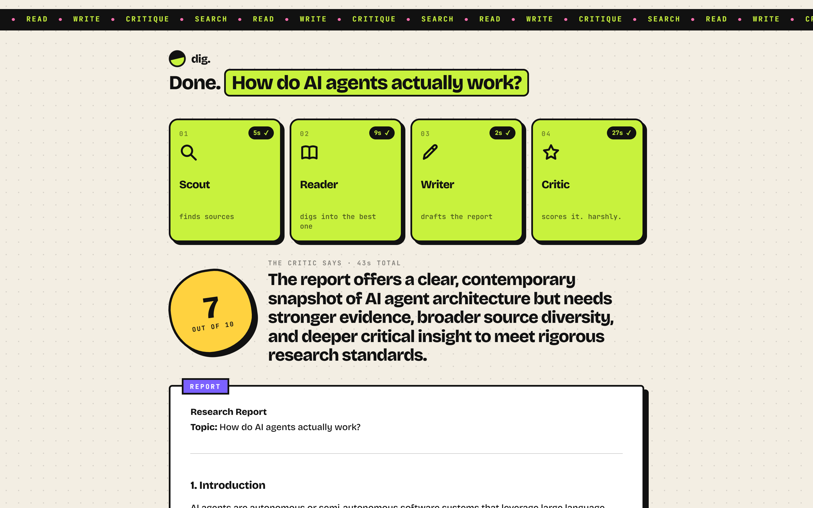

| The report | Critic feedback |
|---|---|
| 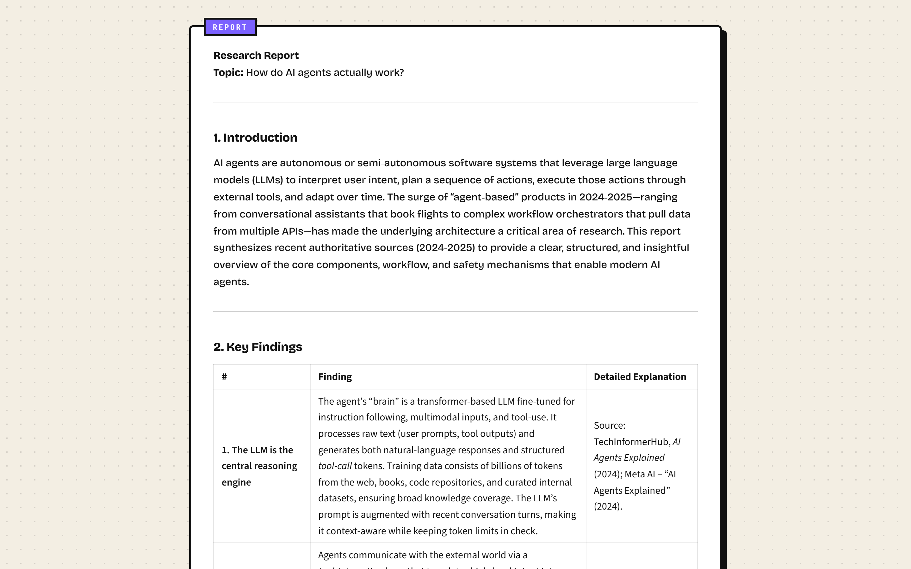 | 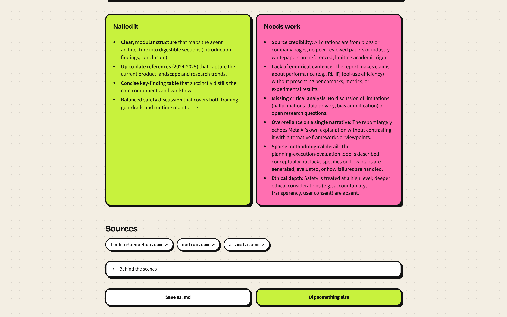 |

<details>
<summary>Full results page</summary>

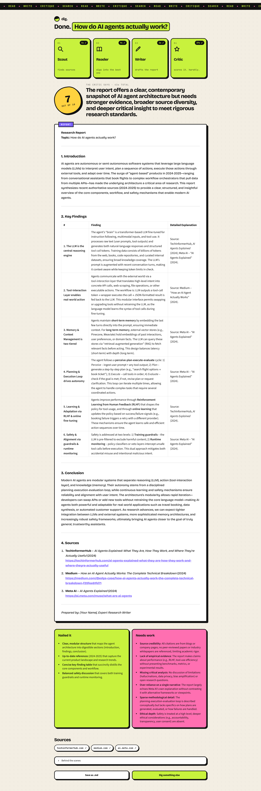

</details>

If an agent fails (a bad API key, say), the page shows the error and lets you retry:

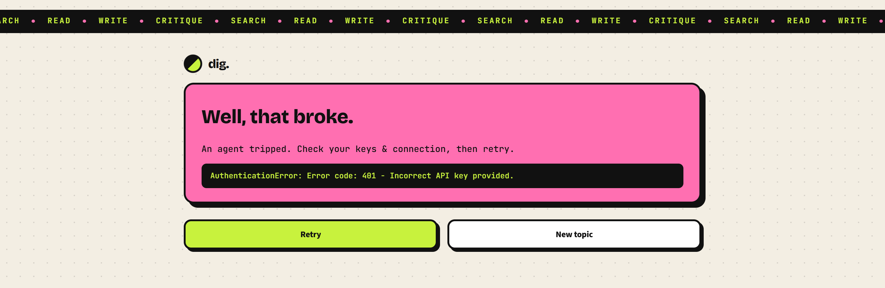

### Mobile

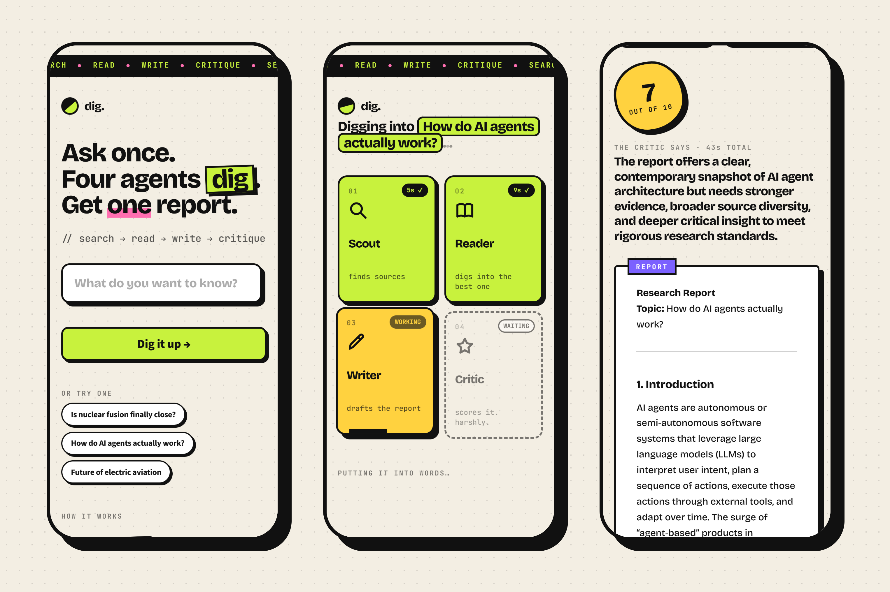

---

## How it works

```
Topic ──► Search Agent ──► Reader Agent ──► Writer Chain ──► Critic Chain ──► Report + Score
          (Tavily)         (scrapes URL)    (LLM report)     (LLM review)
```

| Step | Component | What it does |
|------|-----------|--------------|
| 1 | **Search agent** | Calls `web_search` (Tavily) once and returns titles, URLs and snippets |
| 2 | **Reader agent** | Picks the most relevant URL, calls `scrape_url` once and summarises the page |
| 3 | **Writer chain** | Writes a report: Introduction, Key Findings, Conclusion, Sources |
| 4 | **Critic chain** | Reviews the report and returns `Score: X/10`, strengths, improvements and a one-line verdict |

The search and reader steps are tool-calling **agents**. The writer and critic are plain LLM **chains**. Together they form a small agentic pipeline.

## Project structure

```
├── app.py          # Streamlit UI
├── pipeline.py     # Runs the 4 steps in order (also usable from the CLI)
├── agents.py       # Agents, prompts and model setup
├── tools.py        # web_search, scrape_url, date_today
├── pyproject.toml  # Dependencies (uv)
├── requirements.txt# Dependencies (pip / Render)
├── .streamlit/     # Theme and server config
└── docs/screenshots/ # Images used in this README
```

## Getting started (local)

**Requirements:** Python 3.10+

```bash
git clone <your-repo-url>
cd deep-research-project

# with uv (recommended)
uv sync

# or with pip
python -m venv .venv
source .venv/bin/activate        # Windows: .venv\Scripts\activate
pip install -r requirements.txt
```

Create a `.env` file in the project root:

```env
LLM=openai                  # "openai" or anything else to use Groq
OPENAI_API_KEY=your_key
GROQ_API_KEY=your_key       # only needed if LLM is not "openai"
TAVILY_API_KEY=your_key
```

Run the app:

```bash
streamlit run app.py
```

Or use the CLI version:

```bash
python pipeline.py
```

## Environment variables

| Variable | Required | Description |
|----------|----------|-------------|
| `LLM` | Yes | `openai` uses `gpt-5-nano`. Any other value uses Groq (`openai/gpt-oss-20b`) |
| `OPENAI_API_KEY` | If `LLM=openai` | OpenAI API key |
| `GROQ_API_KEY` | If using Groq | Groq API key |
| `TAVILY_API_KEY` | Yes | Tavily search API key |
| `SITE_URL` | For link previews | Your public URL, e.g. `https://dig.onrender.com`. Used to build the absolute `og:image` URL |

> Never commit your `.env` file. It is already listed in `.gitignore`.

## Deploy on Render

1. Push this repo to GitHub.
2. On [Render](https://render.com), click **New → Web Service** and connect the repo.
3. Use these settings:

   | Setting | Value |
   |---------|-------|
   | Runtime | Python 3 |
   | Build command | `pip install -r requirements.txt` |
   | Start command | `python seo.py && streamlit run app.py --server.port $PORT --server.address 0.0.0.0` |

4. Under **Environment**, add `LLM`, `OPENAI_API_KEY`, `GROQ_API_KEY` (if used) and `TAVILY_API_KEY`.
5. Click **Create Web Service**.

> On Render's free tier the service sleeps after inactivity, so the first request can take about a minute to wake it up.

## Limitations

- One search and one scrape per run, so coverage of broad topics is shallow. Narrow, specific topics score better.
- The critic score is an LLM's opinion, not an objective metric. It is told to be strict, so low scores are normal.
- The pipeline runs once in a fixed order. It does not revise the report after the critique.

## Ideas for next steps

- Allow multiple searches and scrape several sources.
- Feed the critic's feedback back to the writer for an automatic revision loop.
- Export reports as PDF or Markdown.
- Stream the report to the UI as it is written.

## Tech stack

LangChain · Tavily · OpenAI · Groq · BeautifulSoup · Streamlit
